## Merhaba, ben Muhammet Eren Karakalem 

Bayburt Üniversitesi MYO'da **Bilgisayar Programcılığı** 2. sınıf öğrencisiyim. Kodun arka planında neler döndüğünü merak ediyor, web siteleri ve uygulamalar geliştiriyorum.

-  İlgi alanlarım: C++, HTML & CSS ile web tasarımı, WordPress, C# .NET
-  Şu an öğreniyorum: Git ve GitHub
-  Hedefim: yazılım geliştirici olmak
-  İletişim: muhammeteren23230@gmail.com
-  Konum: Elazığ, Türkiye

###  Cephanelik

###  Projelerim

| | Proje | Teknoloji | Açıklama |
|:-:|---|---|---|
|  | **Haber Sitesi** | `WordPress` | WordPress ile kurduğum haber sitesi |
|  | **Haber Sitesi** | `Joomla` | Joomla içerik yönetim sistemiyle hazırladığım haber sitesi |
|  | **Mobil Uygulama** | `MIT App Inventor` | App Inventor ile geliştirdiğim Android uygulaması |
|  | **Masaüstü Uygulama** | `C# .NET` | Windows Forms ile geliştirdiğim C# uygulaması |

###  Sistem Analizi

###  Bağlantı Kur

